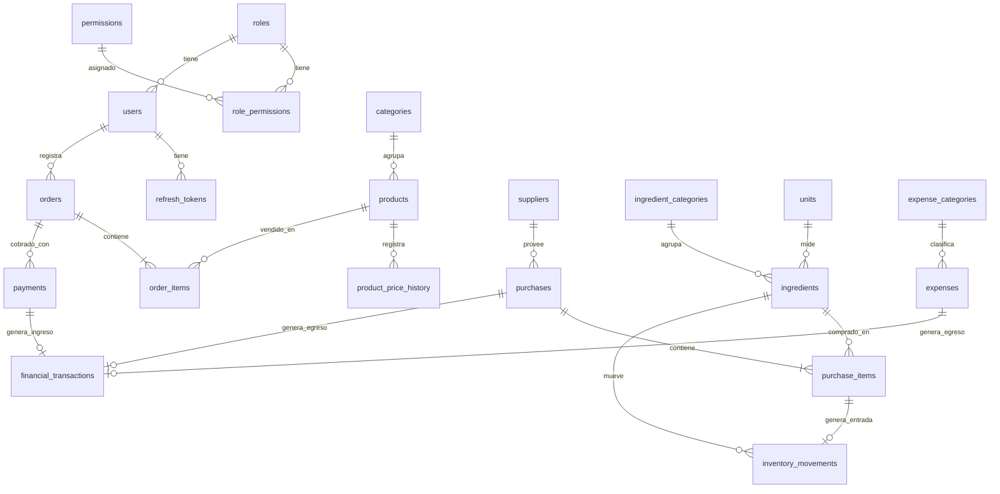

# Modelo de datos

PostgreSQL 18, schema `oveja_negra` (prod) / `oveja_negra_staging` dentro de la BD `gyros`.
Las migraciones (`backend_api/sql/NNN_*.sql`) **nunca nombran el schema**: `migrate.sh` fija el
`search_path`.

## Convenciones

- PK: `id BIGINT GENERATED ALWAYS AS IDENTITY`.
- Toda tabla: `created_at` y `updated_at` `TIMESTAMPTZ NOT NULL DEFAULT now()`
  (`updated_at` lo mantiene un trigger común).
- Dinero: `NUMERIC(12,2)` en bolivianos (Bs). Cantidades de insumo: `NUMERIC(12,3)`.
  Costos unitarios: `NUMERIC(12,4)`.
- Enumerados como `TEXT` + `CHECK (... IN (...))` (más fáciles de migrar que `ENUM`).
- `business_date DATE`: día operativo en La Paz con corte configurable (por defecto 04:00):
  una venta a la 01:30 cuenta para el día anterior.
- Tablas históricas: **sin DELETE**, garantizado por triggers en la BD (no solo en la API):
  - `forbid_delete` (sin DELETE, se anulan por estado): `users`, `categories`, `products`, `orders`,
    `payments`, `suppliers`, `ingredients`, `purchases`, `expense_categories`, `expenses`.
  - `forbid_change` (solo inserción, ni UPDATE ni DELETE): `inventory_movements`,
    `financial_transactions`, `audit_logs`, `product_price_history`, `purchase_items`.
  - `order_items`: solo se modifican con el pedido PENDIENTE y sin pagos confirmados.
- Las fechas que el usuario elige (`purchase_date`, `expense_date`) son las de los reportes; en
  `financial_transactions.business_date` se copia esa fecha. `business_date` calculado por la hora
  de corte solo existe en `orders` y `financial_transactions`.

## Diagrama entidad-relación



## Tablas

### Seguridad

| Tabla | Columnas clave | Restricciones |
|---|---|---|
| `roles` | `code` (ADMIN, CAJERO, ENCARGADO), `name` | `code` UNIQUE |
| `permissions` | `code` (p. ej. `orders.create`), `description` | `code` UNIQUE |
| `role_permissions` | `role_id`, `permission_id` | PK compuesta, FK |
| `users` | `username`, `phone` NULL (E.164), `full_name`, `password_hash`, `role_id`, `is_active`, `last_login_at` | `username` UNIQUE, `phone` UNIQUE |
| `refresh_tokens` | `user_id`, `token_hash`, `expires_at`, `revoked_at`, `replaced_by`, `user_agent` | `token_hash` UNIQUE |
| `auth_attempts` | `ip`, `identifier`, `success`, `created_at` | índice `(identifier, created_at)` |
| `audit_logs` | `user_id`, `entity`, `entity_id`, `action`, `before` JSONB, `after` JSONB | índice `(entity, entity_id)` |

### Catálogo

| Tabla | Columnas clave | Restricciones |
|---|---|---|
| `categories` | `name`, `sort_order`, `is_active` | `name` UNIQUE |
| `products` | `category_id`, `name`, `description`, `price`, `image_path` NULL, `is_active`, `is_available` | `price >= 0`; `(category_id, name)` UNIQUE |
| `product_price_history` | `product_id`, `old_price`, `new_price`, `changed_by` | — |

### Ventas

| Tabla | Columnas clave | Restricciones |
|---|---|---|
| `orders` | `business_date`, `daily_number`, `channel` (WHATSAPP, LOCAL), `status`, `subtotal`, `discount`, `total`, `customer_name` NULL, `customer_phone` NULL, `notes`, `created_by`, `cancelled_by`, `cancelled_at`, `cancel_reason`, `idempotency_key` | `(business_date, daily_number)` UNIQUE; `discount BETWEEN 0 AND subtotal`; `total = subtotal - discount`; `idempotency_key` UNIQUE |
| `order_items` | `order_id`, `product_id`, `product_name_snapshot`, `unit_price_snapshot`, `quantity`, `line_total` | `quantity > 0`; `line_total = unit_price_snapshot * quantity` |
| `payments` | `order_id`, `method` (EFECTIVO, QR), `amount`, `status` (CONFIRMADO, ANULADO), `received_by`, `voided_by`, `idempotency_key` | `amount > 0`; `idempotency_key` UNIQUE |

- `status` del pedido: PENDIENTE → EN_PREPARACION → LISTO → ENTREGADO, solo hacia adelante y con saltos
  permitidos; ENTREGADO exige saldo 0. CANCELADO desde cualquiera antes de ENTREGADO. Transiciones
  validadas en el service.
- El **estado del pago se deriva**: `SUM(payments CONFIRMADO)` contra `total` → sin pagar / parcial / pagado.
  No se permite pagar de más.
- Los ítems solo se editan con el pedido PENDIENTE y sin pagos; si no, se cancela y se crea otro.

### Compras e inventario

| Tabla | Columnas clave | Restricciones |
|---|---|---|
| `suppliers` | `name`, `phone` NULL, `notes`, `is_active` | `name` UNIQUE |
| `units` | `code` (kg, g, l, ml, unidad, paquete), `name` | `code` UNIQUE |
| `ingredient_categories` | `name` | `name` UNIQUE |
| `ingredients` | `name`, `category_id`, `unit_id`, `current_stock`, `min_stock`, `avg_unit_cost`, `is_active` | `name` UNIQUE; `current_stock >= 0`; `min_stock >= 0` |
| `purchases` | `purchase_date`, `supplier_id` NULL, `receipt_number` NULL, `payment_method`, `total`, `status` (CONFIRMADA, ANULADA), `created_by`, `voided_by`, `void_reason`, `idempotency_key` | `total >= 0`; `idempotency_key` UNIQUE |
| `purchase_items` | `purchase_id`, `ingredient_id`, `quantity`, `unit_price` (Bs, 2 decimales), `line_total` | `quantity > 0`; `unit_price >= 0`; `line_total = round(quantity · unit_price, 2)` |
| `inventory_movements` | `ingredient_id`, `type` (ENTRADA_COMPRA, SALIDA_CONSUMO, AJUSTE, REVERSO), `quantity` (con signo), `unit_cost`, `stock_after`, `source_type` (PURCHASE_ITEM, ORDER_ITEM) NULL, `source_id`, `reason`, `created_by` | UNIQUE `(source_type, source_id, type)` cuando `source_id` no es NULL; ENTRADA_COMPRA > 0 y con origen PURCHASE_ITEM; SALIDA_CONSUMO < 0; AJUSTE exige `reason`; índice `(ingredient_id, created_at)` |

- Cada insumo tiene **una única unidad base**; la compra se registra en esa unidad.
- `current_stock` es una caché de `SUM(inventory_movements.quantity)` y se actualiza en la misma
  transacción que el movimiento (`stock_after` permite auditarla).
- El stock no puede quedar negativo. Si una anulación o consumo lo dejaría negativo, se rechaza y
  se pide un ajuste manual con motivo.
- `avg_unit_cost` se recalcula por promedio ponderado en cada entrada y se revierte en la anulación:
  `(stock·avg − q·c) / (stock − q)`; si el stock resultante es 0 se conserva el último costo.

### Finanzas

| Tabla | Columnas clave | Restricciones |
|---|---|---|
| `expense_categories` | `name`, `is_active` | `name` UNIQUE |
| `expenses` | `expense_date`, `category_id`, `description`, `amount`, `payment_method`, `status` (CONFIRMADO, ANULADO), `created_by`, `voided_by`, `void_reason`, `idempotency_key` | `amount > 0` |
| `financial_transactions` | `type` (INGRESO, EGRESO), `category`, `description`, `amount`, `occurred_at`, `business_date`, `source_type` (PAYMENT, PURCHASE, EXPENSE), `source_id`, `is_reversal`, `reverses_id` NULL, `created_by` | `amount > 0`; UNIQUE `(source_type, source_id, is_reversal)`; índice `(business_date, type)` |

- **Ingreso por venta** = un `INGRESO` por cada pago confirmado (soporta pagos mixtos efectivo + QR).
- Cancelar un pedido anula sus pagos y crea un `EGRESO` con `is_reversal = true` por cada ingreso.
  El resultado se calcula como `ingresos − egresos`, así que lo cancelado neto es 0.
- Compra confirmada = un `EGRESO` (PURCHASE) + una `ENTRADA_COMPRA` por ítem, en la misma transacción.
  Al anularla, el reverso del egreso va en la misma `purchase_date`; el de un pago, en el día de la anulación.

## Etapa 2 (preparado, no implementado)

```
recipes(id, product_id FK UNIQUE, …)
recipe_items(recipe_id FK, ingredient_id FK, quantity NUMERIC(12,3))
```

Al confirmar una venta se generaría un `SALIDA_CONSUMO` por ingrediente (`source_type = ORDER_ITEM`),
y el costo por hamburguesa saldría de `quantity · avg_unit_cost`. No requiere cambiar tablas existentes.

## Permisos iniciales

| Permiso | ADMIN | CAJERO | ENCARGADO |
|---|:-:|:-:|:-:|
| `users.manage` · `roles.manage` | ✔ | | |
| `catalog.read` | ✔ | ✔ | ✔ |
| `catalog.manage` (productos, precios, categorías) | ✔ | | |
| `products.availability` | ✔ | ✔ | |
| `orders.create` · `orders.read` · `orders.update_status` · `orders.discount` · `payments.create` | ✔ | ✔ | |
| `orders.cancel` · `payments.void` | ✔ | | |
| `suppliers.manage` · `ingredients.read` · `ingredients.manage` | ✔ | | ✔ |
| `purchases.create` · `purchases.read` · `purchases.void` | ✔ | | ✔ |
| `inventory.read` · `inventory.adjust` · `inventory.consume` | ✔ | | ✔ |
| `expenses.create` · `expenses.read` · `expenses.void` | ✔ | | ✔ |
| `expense_categories.manage` | ✔ | | |
| `finance.read` · `dashboard.read` · `reports.read` | ✔ | | ✔ |

Los permisos son datos (semilla en una migración), así que el ADMIN puede ajustarlos sin tocar código.
